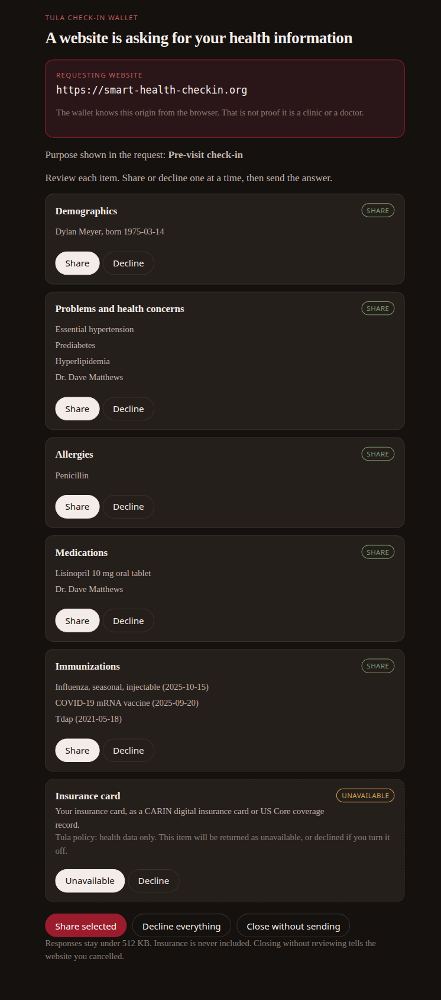
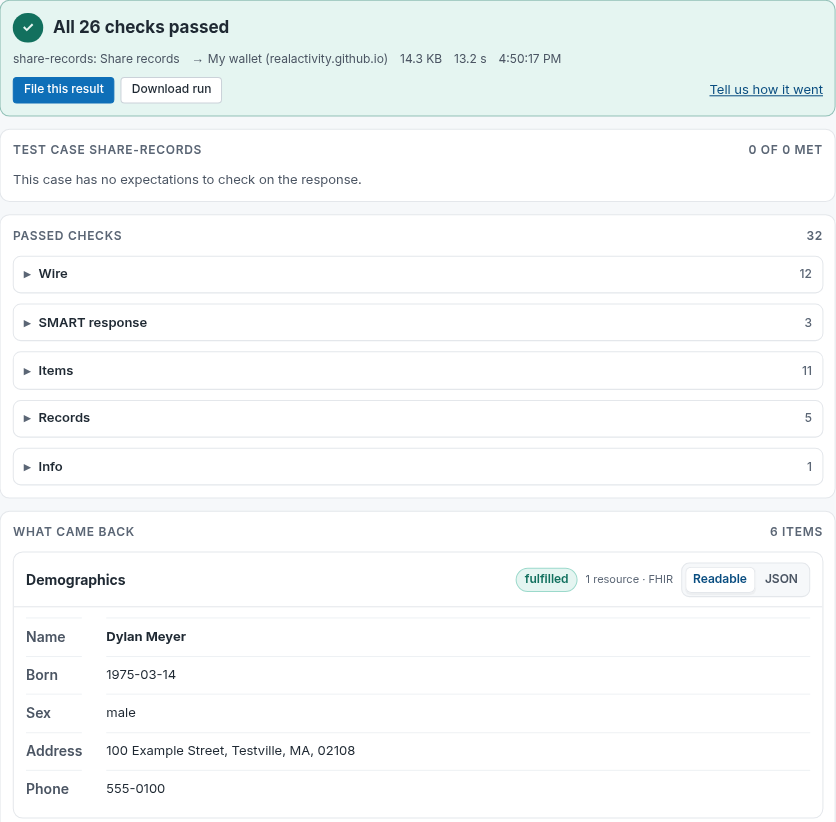

# Interoperability and Conformance

The healthcare standards Tula implements, how each one was tested, and where to find the evidence. This page grows as Tula is tested against more standards, verifiers, and events.

| | |
|---|---|
| **Latest** | Tula Check-in Wallet passes the SMART Health Check-in test suite (October 17, 2026) |
| **Next event** | CMS Kill the Clipboard Connectathon #2, November 3, 2026, 2 to 5 PM ET |
| **Try it** | [realactivity.github.io/tula/check-in-wallet](https://realactivity.github.io/tula/check-in-wallet/) |

---

## Tula Check-in Wallet

Paper clipboards at the front desk ask patients to rewrite what their records already say. [SMART Health Check-in](https://smart-health-checkin.org/) replaces the clipboard with a consented, standards-based handoff: the clinic's check-in page asks for specific records and forms, and the patient's wallet answers with FHIR data the patient approved item by item.

The Tula Check-in Wallet is an open-source web wallet for the SMART Health Check-in 1.0 draft. It lives in [`apps/check-in-wallet/`](../apps/check-in-wallet/) under Apache-2.0.

<p align="center">
  
</p>
<p align="center"><sub>The consent screen during a live request from the SMART Testing EHR. Synthetic patient.</sub></p>

**What the patient sees and controls**

- **Who is asking.** The requesting website's origin, taken from the browser itself and never from the request.
- **Exactly what is asked.** Demographics, problems, allergies, medications, immunizations, and forms, each listed with the records that would be sent.
- **Item-by-item choice.** Share or decline each item, decline everything, or close without sending.
- **Forms inline.** Questionnaires such as the PHQ-2 render in the wallet; sharing waits until every question is answered.
- **Health data only.** Insurance cards are always returned as unavailable, by Tula policy.

**What the clinic receives**

- FHIR R4 (4.0.1) resources as `application/fhir+json`, with US Core profiles where they apply.
- A QuestionnaireResponse that names the exact form the clinic requested.
- A response encrypted to the clinic's key and bound to the clinic's origin, using the [`@smart-health-checkin/client`](https://github.com/smart-health-checkin/client) library from SMART Health IT (Apache-2.0).

### Conformance results

Self-test against the official [SMART Testing EHR](https://smart-health-checkin.org/connectathon/testing-ehr/), the verifier the connectathon uses to check wallets, run against the live wallet URL on October 17, 2026.

| Scenario | Request | Spec checks | Test-case expectations | Response size |
|---|---|---|---|---|
| Share records | `records.json` | **26 of 26 passed** | No expectations defined | 14.3 KB |
| Fill in a form (PHQ-2) | `form-phq2.json` | **19 of 19 passed** | 1 of 1 met | 4.1 KB |
| Decline one item | `records.json` | **25 of 25 passed** | 1 of 1 met | 12.0 KB |
| Unknown selector | `unknown-selector.json` | **18 of 18 passed** | 2 of 2 met | 3.3 KB |
| Decline everything | `records.json` | **21 of 21 passed** | 1 of 1 met | 2.2 KB |

The first three rows are the connectathon's minimum scenarios. Every response is well under the connectathon's 512 KB limit.

<p align="center">
  
</p>
<p align="center"><sub>The SMART Testing EHR verdict for the share-records scenario.</sub></p>

**Run it yourself.** Open the Testing EHR with the Tula wallet preselected, choose a request, and press Send:

[smart-health-checkin.org/connectathon/testing-ehr/#walletUrl=...check-in-wallet](https://smart-health-checkin.org/connectathon/testing-ehr/#case=share-records&walletUrl=https%3A%2F%2Frealactivity.github.io%2Ftula%2Fcheck-in-wallet%2F)

### Connectathon status

| Step | Status |
|---|---|
| Wallet built, tested, and merged | Done |
| Public https URL | Live on GitHub Pages |
| Self-test on the SMART Testing EHR | All scenarios above pass |
| Connectathon registration | Pending |
| Official results filed | Pending |
| Live testing with participating EHRs | November 3, 2026 |

### How it works

The whole exchange happens in the patient's browser. The wallet is a static site with a bundled synthetic chart; it holds no server, database, or secrets, and it never connects to a Tula VM.

```
Patient's browser
  +--------------------------+   opens    +---------------------------+
  | Clinic check-in page     | ---------> | Tula Check-in Wallet      |
  | (EHR, kiosk, portal)     |            | (static site, https)      |
  |                          | <--------- |                           |
  +--------------------------+  encrypted +---------------------------+
               |                FHIR response
               v
     Clinic's own server
```

Architecture, deploy steps, and test commands are in the wallet [README](../apps/check-in-wallet/README.md).

---

## Standards

| Standard | Where in Tula | How it is verified |
|---|---|---|
| [SMART Health Check-in 1.0](https://smart-health-checkin.org/) (draft) | [`apps/check-in-wallet`](../apps/check-in-wallet/) | Live SMART Testing EHR runs (above); spec checks in the unit tests on every pull request |
| [HL7 FHIR R4](https://hl7.org/fhir/R4/) (4.0.1) | Check-in wallet, [`health-records`](../skills/health-records/) | Testing EHR record checks for the wallet; FHIR R4 bundles pulled from patient portals |
| [US Core](https://hl7.org/fhir/us/core/) profiles | Check-in wallet resources | Profiles declared with required fields; a full US Core validator run is planned |
| [SMART App Launch](https://hl7.org/fhir/smart-app-launch/) (patient-facing OAuth) | [`health-records`](../skills/health-records/) and the [Wren relay](../services/wren/) | Epic sandbox walkthrough and a live Epic MyChart pull ([demo at 10:00](https://youtu.be/FcLl6fASpgw?t=600)) |
| [International Patient Summary](https://hl7.org/fhir/uv/ips/) | [`prep-my-visit`](../skills/prep-my-visit/) | IPS-aligned output, covered by the skill's [Waza eval suite](../evals/prep-my-visit/) |

## Integrations

| System | Path | Status |
|---|---|---|
| Epic MyChart | `health-records` skill via the Wren relay, SMART on FHIR | Live in the reference deployment; Epic production registration (Lane 2) in progress |
| Oracle Health (Cerner) patient portals | `health-records` skill, SMART on FHIR | Supported by the skill |
| SMART Health Check-in verifiers | Check-in wallet, browser `postMessage` | Passing on the SMART Testing EHR; participant EHRs at the connectathon |

## What these results mean

These are conformance self-tests against published test tools, and participation in community testing events. They are not a certification, endorsement, or approval by CMS, ONC, HL7, or any EHR vendor. All testing uses a synthetic patient (Dylan Meyer); no real patient data is used.

Tula is not a medical device. See [`safety-and-disclaimer.md`](safety-and-disclaimer.md).

## See also

- [`apps/check-in-wallet/README.md`](../apps/check-in-wallet/README.md) - wallet architecture, tests, and deploy
- [`docs/roadmap.md`](roadmap.md) - component status
- [`docs/evals.md`](evals.md) - eval compliance across all skills
- [`OPEN_CORE.md`](../OPEN_CORE.md) - what is open in Tula and what is part of Aria
